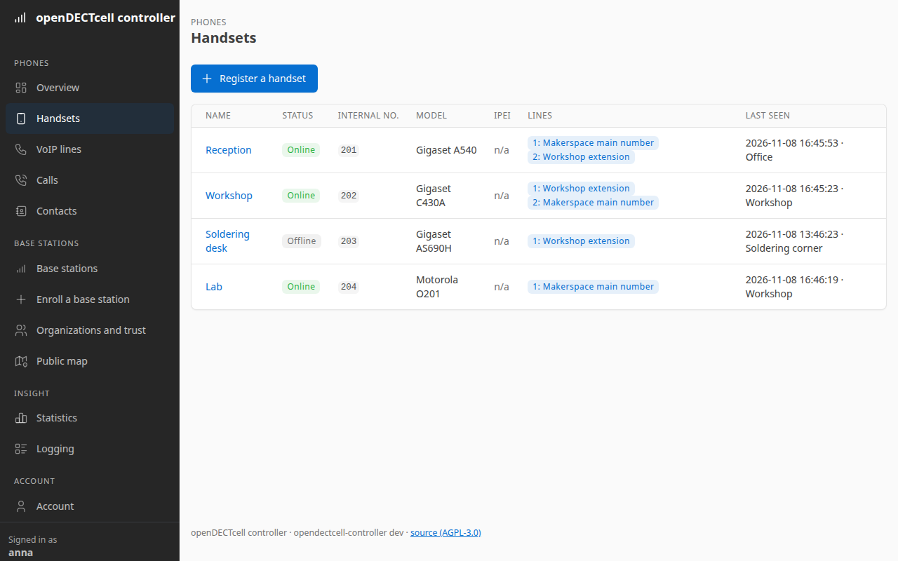
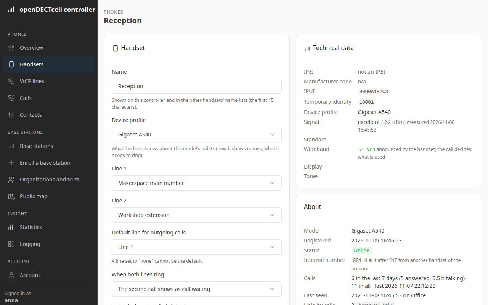
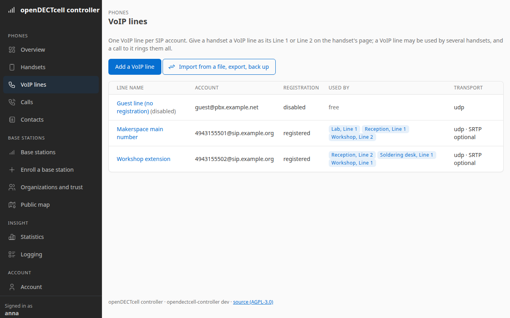
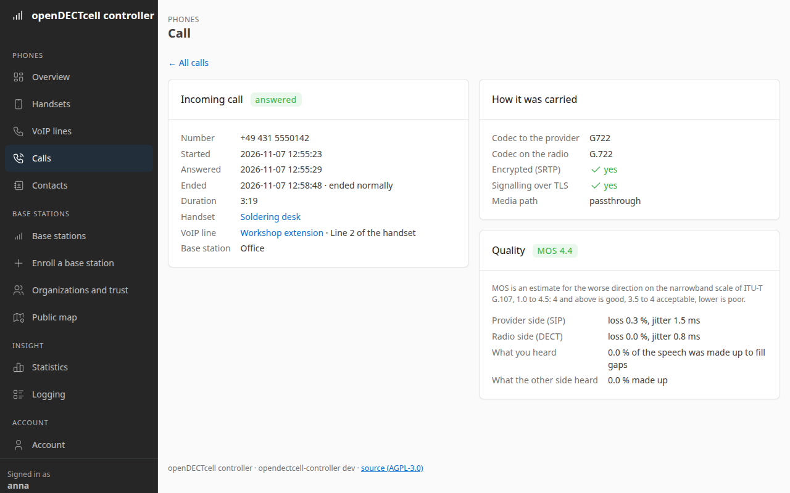
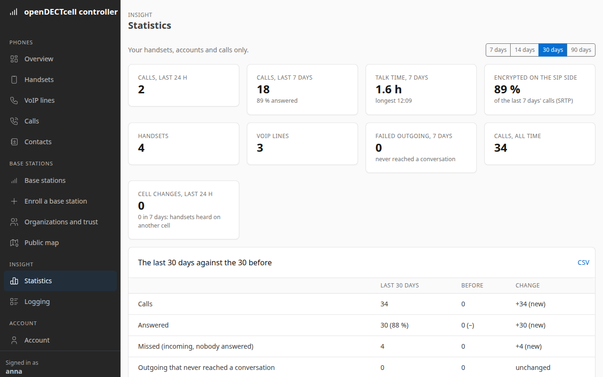
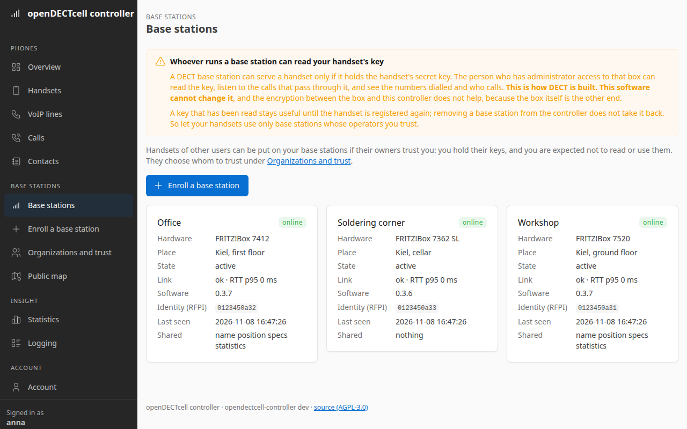

# Screenshots

The controller's web interface with example entries. Everything on the pages is made up: the users, handsets, numbers and
the SIP provider (`sip.example.org`) belong to an imaginary makerspace, and the base stations are test stand-ins. The
pages show the view of an ordinary user; an administrator has further pages for users, all base stations, the audit log,
settings and backups.

## Handsets

The handsets of one user: whether each is online, its internal number (dialled after INT from another handset of the
account), its model and the two VoIP lines it uses.

A handset's page. On the left what the user can set: the name other handsets show, the device profile (how the base
treats this model's habits), the two lines, the default line for outgoing calls and what happens when both lines ring.
On the right the technical data, the measured signal and the call history of the handset.

## VoIP lines

A VoIP line is a SIP account. The list shows whether it is registered, which handsets use it as Line 1 or Line 2, and
the transport. One line can serve several handsets: a call to it rings them all.

## Calls

A call's page: who called, which handset and line, which base station carried it, the codec towards the provider and on
the radio, whether signalling (TLS) and speech (SRTP) were encrypted, and an estimate of the quality (MOS) with loss and
jitter on both legs.

## Statistics

Figures about the user's own handsets, lines and calls: how many calls, how many were answered, talk time, the share of
calls encrypted on the SIP side, failed outgoing calls and the change against the period before.

## Base stations

The cells (FRITZ!Boxes running the openDECTcell software) that serve the user's handsets, with their state and link, the
software version, the identity they broadcast and what their owner shares publicly. The warning at the top states
plainly that whoever runs a base station can read the keys of the handsets on it.
